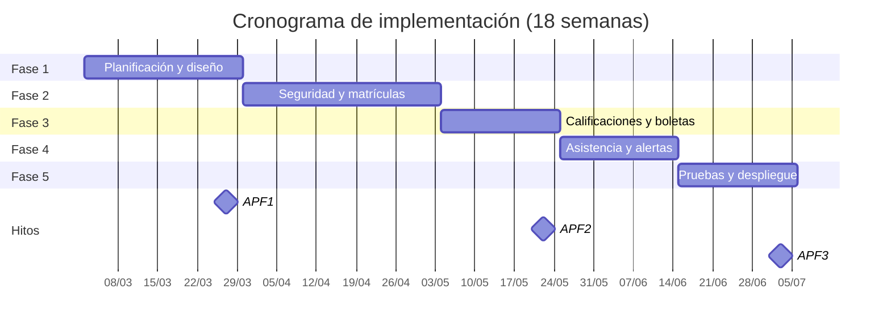

# Plan de Implementación: Sistema de Control de Seguimiento Académico y Matrículas

**Institución:** Prime School — Proyecto Integrador I
**Versión:** 2.1 (alineada al esquema real `docs/schema.sql`)
**Última actualización:** Octubre de 2026

---

## 1. Visión General del Proyecto

### 1.1 Descripción

Sistema web cliente-servidor organizado en capas (vista, controlador, servicio y repositorio) para automatizar los procesos de matrícula, registro de calificaciones por curso y periodo, control de asistencia, generación de boletas y alertas tempranas de rendimiento académico.

### 1.2 Alcance

El sistema cubre los siguientes módulos:

1. **Seguridad y usuarios:** autenticación, autorización por roles y control de acceso.
2. **Matrículas y secciones:** gestión de estudiantes, apoderados, periodos, grados, secciones, cursos y control transaccional de vacantes.
3. **Calificaciones y boletas:** registro de notas por curso y periodo, cálculo de promedios y emisión de boletas.
4. **Asistencia y alertas tempranas:** registro diario de asistencia, detección de riesgo por reprobación, deserción o inasistencia, y consulta desde el portal del apoderado.
5. **Reportes:** dashboards y consultas consolidadas por rol.

**Fuera de alcance (trabajo futuro):** gestión de pagos, planilla docente, biblioteca, aplicación móvil, integración con sistemas externos, evaluaciones ponderadas por componentes, notificaciones por correo, auditoría persistente en base de datos y gestión multianual de secciones.

> El modelo de datos vigente es el definido en `docs/schema.sql` (12 tablas) y ya fue creado en PostgreSQL, en la base de datos `colegio_db`. Este plan no propone tablas adicionales; las brechas se documentan en la sección 5.6.

### 1.3 Enfoque arquitectónico

Se adopta una **arquitectura web cliente-servidor en tres capas lógicas** desplegables (presentación, negocio y datos), con separación interna estricta en vista, controlador, servicio y repositorio. El frontend se renderiza en el servidor con JSP y el backend se implementa con Spring Boot MVC. No se plantea una arquitectura de microservicios: el sistema es un monolito modular desplegado como una aplicación WAR sobre Tomcat con base de datos PostgreSQL.

---

## 2. Objetivos e Indicadores

### 2.1 Objetivo general

Desarrollar e implementar un sistema web integral que automatice los procesos de matrícula, registro de calificaciones y asistencia, y generación de alertas tempranas de rendimiento académico, aplicando una arquitectura por capas con interfaces.

### 2.2 Objetivos específicos e indicadores

| N.º | Objetivo específico | Indicador de logro |
|---|---|---|
| 1 | Diseñar un módulo de matrículas y asignación de secciones con control de vacantes. | 100 % de matrículas registradas sin sobrepasar la capacidad de la sección, incluso en concurrencia. |
| 2 | Implementar el registro de calificaciones por curso y periodo, y la generación de boletas. | 100 % de notas entre 0 y 20, una por curso y periodo; boletas generadas en menos de 5 segundos. |
| 3 | Establecer control de acceso por roles (Administrador, Docente, Directivo, Apoderado) con mecanismos de autenticación seguros. | 100 % de rutas protegidas, contraseñas almacenadas con BCrypt y cero hallazgos críticos de seguridad. |
| 4 | Automatizar la generación de alertas tempranas por bajo rendimiento o inasistencia. | Alerta generada dentro del minuto siguiente al registro de una nota o asistencia que cruce el umbral configurado. |

---

## 3. Stack Tecnológico y Arquitectura

### 3.1 Stack tecnológico

| Capa / Área | Tecnología |
|---|---|
| Lenguaje backend | Java 17 |
| Framework backend | Spring Boot 3.2 (Spring MVC, Spring Security, Spring Data JPA, Bean Validation) |
| Frontend | JSP, JSTL 3.0, Bootstrap 5, JavaScript (fetch API), Chart.js |
| Base de datos | PostgreSQL 16; esquema `docs/schema.sql` ya aplicado en `colegio_db` |
| Migraciones | Script base `schema.sql` y scripts incrementales controlados; la base ya existe |
| Build | Maven |
| Pruebas | JUnit 5, Mockito, Spring Boot Test, MockMvc, Testcontainers |
| Servidor de aplicaciones | Tomcat 10.1 (empaquetado WAR) |
| Despliegue | Docker y Docker Compose |
| Herramientas | Git, GitHub, Postman, IntelliJ IDEA |

### 3.2 Arquitectura por capas

```
┌─────────────────────────────────────────────────────┐
│ Vista (JSP + JSTL + Bootstrap 5)                    │
│ Renderiza HTML, formularios y componentes visuales  │
└───────────────────────┬─────────────────────────────┘
                        │ HTTP (GET/POST)
┌───────────────────────▼─────────────────────────────┐
│ Controlador (@Controller / @RestController)         │
│ Recibe la petición, valida entrada y delega         │
└───────────────────────┬─────────────────────────────┘
                        │ interfaz de servicio
┌───────────────────────▼─────────────────────────────┐
│ Servicio (interfaz XxxService + XxxServiceImpl)     │
│ Reglas de negocio y transacciones (@Transactional)  │
└───────────────────────┬─────────────────────────────┘
                        │ interfaz de repositorio
┌───────────────────────▼─────────────────────────────┐
│ Repositorio (interfaces Spring Data JPA)            │
│ Acceso a datos y consultas personalizadas           │
└───────────────────────┬─────────────────────────────┘
                        │ JPA / Hibernate
┌───────────────────────▼─────────────────────────────┐
│ PostgreSQL (`colegio_db`, 12 tablas)                │
└─────────────────────────────────────────────────────┘
```

| Capa | Responsabilidad | Componentes |
|---|---|---|
| Vista | Presentación y captura de datos. No contiene lógica de negocio ni acceso a datos. | Archivos JSP, fragmentos, etiquetas JSTL, CSS y JS. |
| Controlador | Atender peticiones HTTP, validar datos de entrada, invocar servicios y resolver la vista o respuesta JSON. | Clases `@Controller` por módulo. |
| Servicio | Implementar reglas de negocio, validaciones de dominio, transacciones y coordinación entre repositorios. | Interfaces `XxxService` e implementaciones `XxxServiceImpl`. |
| Repositorio | Abstraer el acceso a la base de datos y las consultas. | Interfaces que extienden `JpaRepository`. |

### 3.3 Reglas de dependencia

- La vista **nunca** accede directamente a servicios ni a repositorios; solo consume el modelo entregado por el controlador.
- El controlador **no contiene lógica de negocio**: valida la entrada, delega en una interfaz de servicio y resuelve la navegación.
- Los servicios concentran las reglas de negocio y delimitan las transacciones con `@Transactional`.
- Los repositorios solo contienen operaciones de persistencia y consultas; no incluyen reglas de negocio.
- Toda dependencia se declara contra **interfaces**, nunca contra implementaciones concretas.
- La inyección de dependencias se realiza por **constructor**.
- Las entidades JPA no se exponen en la vista: se usan DTOs y mappers.
- Las excepciones de negocio se manejan de forma centralizada con `@ControllerAdvice`.

### 3.4 Estructura de paquetes

```
com.primeschool.matricula
├── config/          SecurityConfig, WebConfig
├── controller/      MatriculaController, NotaController, AsistenciaController...
├── service/         interfaces de negocio (MatriculaService, NotaService...)
│   └── impl/        implementaciones @Service (MatriculaServiceImpl...)
├── repository/      interfaces Spring Data JPA
├── model/entity/    entidades JPA (Rol, Usuario, Estudiante, Matricula...)
├── dto/             request/response y validaciones
├── mapper/          conversión entidad ↔ DTO
├── exception/       excepciones de negocio y handler global
└── src/main/webapp/WEB-INF/jsp/   vistas JSP
```

### 3.5 Uso de interfaces

- Cada módulo funcional define una **interfaz de servicio** y su implementación:

```java
public interface MatriculaService {
    MatriculaDTO registrar(MatriculaRequest request);
    void anular(Integer matriculaId);
    List<VacanteDTO> consultarVacantes(Integer periodoId);
}

@Service
public class MatriculaServiceImpl implements MatriculaService {
    private final MatriculaRepository matriculaRepository;
    private final SeccionRepository seccionRepository;

    public MatriculaServiceImpl(MatriculaRepository matriculaRepository,
                                SeccionRepository seccionRepository) {
        this.matriculaRepository = matriculaRepository;
        this.seccionRepository = seccionRepository;
    }

    @Override
    @Transactional
    public MatriculaDTO registrar(MatriculaRequest request) {
        // Validaciones y control transaccional de vacantes.
    }
}
```

- Cada **repositorio** es una interfaz que extiende `JpaRepository` y declara consultas derivadas o con `@Query`:

```java
public interface MatriculaRepository extends JpaRepository<Matricula, Integer> {
    Optional<Matricula> findByEstudiante_IdEstudianteAndPeriodo_IdPeriodo(
            Integer estudianteId, Integer periodoId);

    @Query("select count(m) from Matricula m " +
           "where m.seccion.idSeccion = :seccionId and m.estado in :estados")
    long contarVigentes(@Param("seccionId") Integer seccionId,
                        @Param("estados") Collection<String> estados);
}
```

- Los **controladores** dependen de la interfaz del servicio, no de la implementación:

```java
@Controller
@RequestMapping("/matriculas")
public class MatriculaController {
    private final MatriculaService matriculaService;

    public MatriculaController(MatriculaService matriculaService) {
        this.matriculaService = matriculaService;
    }
}
```

**Convenciones:** `XxxService` / `XxxServiceImpl`, `XxxRepository`, `XxxController`, `XxxRequest` / `XxxResponse`, entidades en singular y tablas en snake_case.

### 3.6 Consideraciones sobre JSP y empaquetado

- Spring Boot 3.x soporta JSP únicamente con empaquetado **WAR**; se despliega en Tomcat 10.1 o como WAR ejecutable con las dependencias `tomcat-embed-jasper` y JSTL 3.0.
- Las vistas se ubican en `src/main/webapp/WEB-INF/jsp` para impedir el acceso directo.
- Los recursos estáticos (CSS, JS, imágenes) se sirven desde `src/main/resources/static`.
- Las vistas usan JSTL para iteración y condicionales, y `<c:out>` para escapar la salida y prevenir XSS.
- Los endpoints AJAX (validaciones, dashboards) devuelven JSON y están protegidos por la misma sesión y token CSRF.

### 3.7 Esquema vigente y cumplimiento de requisitos

- **Base de datos existente:** `colegio_db` contiene las 12 tablas de `docs/schema.sql`: `rol`, `usuario`, `apoderado`, `grado`, `seccion`, `estudiante`, `periodo_academico`, `matricula`, `curso`, `nota`, `asistencia` y `alerta_temprana`. El script incluye datos de prueba y roles PostgreSQL (`rol_*` y `usr_*`).
- **Backend ≥ 50 % del código:** entidades, repositorios, servicios, controladores, seguridad, validaciones y pruebas se implementan en Java; JSP y JavaScript se limitan a la presentación.
- **Patrones de UI:** Cards, Breadcrumbs, Tabs, Modales y Toast implementados con JSP/JSTL y Bootstrap 5.
- **Base de datos normalizada:** modelo relacional con claves y restricciones. El contador `seccion.vacantes_disponibles` es un dato denormalizado controlado por la capa de servicio (sección 5.4).
- **Seguridad:** RBAC en la capa de servicio, BCrypt, sesiones y protección CSRF.
- **Documentación:** entregables por fase y criterios de aceptación verificables.

---

## 4. Requerimientos

### 4.1 Roles y matriz de permisos

La matriz se aplica en la capa de servicio. Los roles PostgreSQL creados por `schema.sql` (`rol_admin`, `rol_docente`, `rol_directivo`, `rol_apoderado`) se usan para acceso directo y pruebas; no sustituyen la autorización de la aplicación (ver sección 8).

> **"Sus secciones":** el esquema actual solo registra un tutor por sección (`seccion.id_tutor`); por tanto, el docente habilitado para registrar notas y asistencia es el tutor de la sección. No existe asignación docente-curso en el esquema vigente.

| Acción | Administrador | Docente | Directivo | Apoderado |
|---|---|---|---|---|
| Gestionar usuarios y roles | Sí | No | No | No |
| Gestionar apoderados, estudiantes, grados, secciones, cursos y periodos | Sí | No | No | No |
| Registrar y anular matrículas | Sí | No | No | No |
| Consultar matrículas y vacantes | Sí | No | Sí | No |
| Registrar y corregir notas por curso y periodo | No | Sí (sus secciones) | No | No |
| Registrar y corregir asistencia | No | Sí (sus secciones) | No | No |
| Consultar notas y asistencia | Sí | Sí (sus secciones) | Sí | Sí (sus hijos) |
| Generar y descargar boletas | Sí | Sí (sus secciones) | Sí | Sí (sus hijos) |
| Ver alertas | Sí | Sí (sus secciones) | Sí | Sí (sus hijos) |
| Atender y cerrar alertas | Sí | Sí (sus secciones) | Sí | No |
| Ver reportes y dashboards | Sí | Sí (sus secciones) | Sí | No |
| Configurar umbrales de alerta (archivo de configuración) | Sí | No | No | No |

### 4.2 Historias de usuario

| ID | Rol | Historia | Prioridad |
|---|---|---|---|
| US-01 | Administrador | Gestionar usuarios, roles y cuentas de apoderados para controlar el acceso al sistema. | Alta |
| US-02 | Administrador | Registrar y actualizar estudiantes y apoderados. | Alta |
| US-03 | Administrador | Crear periodos, grados, secciones y cursos con su capacidad y docente tutor. | Alta |
| US-04 | Administrador | Matricular a un estudiante validando la disponibilidad de vacantes. | Alta |
| US-05 | Administrador | Anular una matrícula, liberando la vacante correspondiente. | Media |
| US-06 | Docente | Registrar y corregir notas por curso y periodo de los estudiantes de su sección. | Alta |
| US-07 | Docente | Registrar y corregir la asistencia diaria de su sección. | Alta |
| US-08 | Docente | Consultar notas, promedios y alertas de su sección. | Media |
| US-09 | Directivo | Generar boletas de notas por estudiante, sección o periodo. | Alta |
| US-10 | Directivo | Consultar alertas y reportes, y marcar alertas como atendidas. | Media |
| US-11 | Apoderado | Consultar notas, asistencia y alertas de sus hijos. | Alta |
| US-12 | Administrador | Consultar reportes consolidados de matrícula y rendimiento. | Media |

### 4.3 Requisitos no funcionales

| Categoría | Requisito |
|---|---|
| Rendimiento | Consultas típicas en menos de 2 segundos y boletas en menos de 5 segundos. |
| Concurrencia | Soportar 100 usuarios simultáneos; la matrícula debe resistir condiciones de carrera. |
| Disponibilidad | 99 % en horario académico, con respaldo diario de la base de datos. |
| Seguridad | OWASP Top 10 mitigado, BCrypt, CSRF, RBAC y sesiones seguras. |
| Usabilidad | Interfaz responsiva con Bootstrap 5 y los cinco patrones de UI definidos. |
| Compatibilidad | Últimas versiones de Chrome, Edge y Firefox. |
| Mantenibilidad | Arquitectura por capas, interfaces y cobertura de pruebas ≥ 70 % en servicios. |
| Integridad | Operaciones transaccionales ACID, restricciones declarativas y conciliación de vacantes. |
| Codificación | Archivos y base de datos en UTF-8. |
| Registro | Login y acciones críticas registrados en logs de aplicación; no hay tabla de auditoría en el esquema actual. |

### 4.4 Patrones de interfaz de usuario

- **Cards:** resúmenes de vacantes, promedios y alertas en dashboards.
- **Breadcrumbs:** ubicación del usuario dentro de cada módulo.
- **Tabs:** detalle del estudiante (datos, matrícula, notas, asistencia, alertas).
- **Modales:** confirmación de anulación de matrícula y edición rápida.
- **Toast:** confirmación de operaciones exitosas o errores de validación.

---

## 5. Modelo de Datos

### 5.1 Principios de diseño

- Modelo implementado en `docs/schema.sql`; **no se crean tablas adicionales** en esta versión.
- 12 tablas en tercera forma normal, salvo el contador controlado `seccion.vacantes_disponibles`, justificado por rendimiento y mantenido por el servicio.
- Claves primarias con `INT GENERATED ALWAYS AS IDENTITY`; claves foráneas explícitas con integridad referencial.
- Nomenclatura en snake_case para tablas y columnas, singular para entidades.
- Uso de estados (`matricula.estado`, `asistencia.estado`, `usuario.activo`) para conservar historial.
- Valores derivados (promedios, alertas) se calculan en la capa de servicio.
- El esquema actual no incluye evaluaciones ponderadas, notificaciones, auditoría, permisos granulares ni configuración de umbrales en base de datos; se documentan como brechas en la sección 5.6.

### 5.2 Diccionario de datos

#### Tabla `rol`

| Campo | Tipo | Restricciones | Descripción |
|---|---|---|---|
| id_rol | INT | PK, identity | Identificador del rol. |
| nombre_rol | VARCHAR(30) | UNIQUE, NOT NULL | ADMINISTRADOR, DOCENTE, DIRECTIVO o APODERADO. |

#### Tabla `usuario`

| Campo | Tipo | Restricciones | Descripción |
|---|---|---|---|
| id_usuario | INT | PK, identity | Identificador del usuario. |
| id_rol | INT | FK → `rol(id_rol)`, NOT NULL | Rol asignado. |
| nombres | VARCHAR(100) | NOT NULL | Nombres. |
| apellidos | VARCHAR(100) | NOT NULL | Apellidos. |
| correo | VARCHAR(120) | UNIQUE, NOT NULL | Correo de acceso. |
| contrasena_hash | VARCHAR(255) | NOT NULL | Contraseña cifrada con BCrypt. |
| activo | BOOLEAN | NOT NULL, DEFAULT TRUE | Cuenta habilitada. |
| fecha_creacion | TIMESTAMP | NOT NULL, DEFAULT CURRENT_TIMESTAMP | Fecha de creación. |

#### Tabla `apoderado`

| Campo | Tipo | Restricciones | Descripción |
|---|---|---|---|
| id_apoderado | INT | PK, identity | Identificador del apoderado. |
| id_usuario | INT | UNIQUE, FK → `usuario(id_usuario)`, NOT NULL | Cuenta de acceso del apoderado; sus nombres y correo están en `usuario`. |
| dni | CHAR(8) | UNIQUE, NOT NULL | Documento de identidad. |
| telefono | VARCHAR(15) | NULL | Teléfono de contacto. |

#### Tabla `grado`

| Campo | Tipo | Restricciones | Descripción |
|---|---|---|---|
| id_grado | INT | PK, identity | Identificador del grado. |
| nombre_grado | VARCHAR(30) | NOT NULL | Por ejemplo `1° Secundaria`. |
| nivel | VARCHAR(20) | NOT NULL | Nivel educativo (Primaria, Secundaria). |
| — | — | UNIQUE `(nombre_grado, nivel)` | Evita grados duplicados. |

#### Tabla `seccion`

| Campo | Tipo | Restricciones | Descripción |
|---|---|---|---|
| id_seccion | INT | PK, identity | Identificador de la sección. |
| id_grado | INT | FK → `grado(id_grado)`, NOT NULL | Grado al que pertenece. |
| id_tutor | INT | FK → `usuario(id_usuario)`, NOT NULL | Docente tutor de la sección. |
| nombre_seccion | VARCHAR(5) | NOT NULL | Identificador, por ejemplo `A`. |
| vacantes_totales | INT | CHECK (`vacantes_totales > 0`), NOT NULL | Capacidad total. |
| vacantes_disponibles | INT | CHECK (`vacantes_disponibles >= 0`), NOT NULL | Vacantes libres; se controla desde el servicio. |
| — | — | UNIQUE `(id_grado, nombre_seccion)`; CHECK (`vacantes_disponibles <= vacantes_totales`) | Sección única por grado y coherencia de vacantes. |

#### Tabla `estudiante`

| Campo | Tipo | Restricciones | Descripción |
|---|---|---|---|
| id_estudiante | INT | PK, identity | Identificador del estudiante. |
| id_apoderado | INT | FK → `apoderado(id_apoderado)`, NOT NULL | Apoderado responsable. |
| codigo | VARCHAR(15) | UNIQUE, NOT NULL | Código institucional del estudiante. |
| nombres | VARCHAR(100) | NOT NULL | Nombres. |
| apellidos | VARCHAR(100) | NOT NULL | Apellidos. |
| fecha_nacimiento | DATE | NOT NULL | Fecha de nacimiento. |

#### Tabla `periodo_academico`

| Campo | Tipo | Restricciones | Descripción |
|---|---|---|---|
| id_periodo | INT | PK, identity | Identificador del periodo. |
| nombre_periodo | VARCHAR(30) | UNIQUE, NOT NULL | Por ejemplo `Año Escolar 2026` o `Bimestre 1`. |
| fecha_inicio | DATE | NOT NULL | Inicio del periodo. |
| fecha_fin | DATE | NOT NULL | Fin del periodo. |
| — | — | CHECK (`fecha_fin > fecha_inicio`) | Coherencia de fechas. |

#### Tabla `matricula`

| Campo | Tipo | Restricciones | Descripción |
|---|---|---|---|
| id_matricula | INT | PK, identity | Identificador de la matrícula. |
| id_estudiante | INT | FK → `estudiante(id_estudiante)`, NOT NULL | Estudiante matriculado. |
| id_seccion | INT | FK → `seccion(id_seccion)`, NOT NULL | Sección asignada. |
| id_periodo | INT | FK → `periodo_academico(id_periodo)`, NOT NULL | Periodo anual de la matrícula. |
| fecha_matricula | DATE | NOT NULL, DEFAULT CURRENT_DATE | Fecha de registro. |
| estado | VARCHAR(20) | CHECK (`estado IN ('PENDIENTE','CONFIRMADA','ANULADA')`), NOT NULL, DEFAULT 'PENDIENTE' | Estado de la matrícula. |
| — | — | UNIQUE `(id_estudiante, id_periodo)` | Una matrícula por estudiante y periodo. |

#### Tabla `curso`

| Campo | Tipo | Restricciones | Descripción |
|---|---|---|---|
| id_curso | INT | PK, identity | Identificador del curso. |
| nombre_curso | VARCHAR(80) | UNIQUE, NOT NULL | Nombre del curso. |
| competencia | VARCHAR(150) | NULL | Competencia evaluada. |

#### Tabla `nota`

| Campo | Tipo | Restricciones | Descripción |
|---|---|---|---|
| id_nota | INT | PK, identity | Identificador de la nota. |
| id_matricula | INT | FK → `matricula(id_matricula)`, NOT NULL | Matrícula del estudiante. |
| id_curso | INT | FK → `curso(id_curso)`, NOT NULL | Curso evaluado. |
| id_periodo | INT | FK → `periodo_academico(id_periodo)`, NOT NULL | Periodo de evaluación (bimestre). |
| id_docente | INT | FK → `usuario(id_usuario)`, NOT NULL | Docente que registró la nota. |
| calificacion | NUMERIC(4,2) | CHECK (`calificacion BETWEEN 0 AND 20`), NOT NULL | Calificación vigesimal. |
| fecha_registro | TIMESTAMP | NOT NULL, DEFAULT CURRENT_TIMESTAMP | Fecha y hora del registro. |
| — | — | UNIQUE `(id_matricula, id_curso, id_periodo)` | Una nota final por curso y periodo. |

#### Tabla `asistencia`

| Campo | Tipo | Restricciones | Descripción |
|---|---|---|---|
| id_asistencia | INT | PK, identity | Identificador del registro. |
| id_matricula | INT | FK → `matricula(id_matricula)`, NOT NULL | Matrícula del estudiante. |
| fecha | DATE | NOT NULL | Fecha de asistencia. |
| estado | VARCHAR(15) | CHECK (`estado IN ('ASISTIO','FALTA','TARDANZA','JUSTIFICADA')`), NOT NULL | Estado del día. |
| — | — | UNIQUE `(id_matricula, fecha)` | Un registro por estudiante y día. |

#### Tabla `alerta_temprana`

| Campo | Tipo | Restricciones | Descripción |
|---|---|---|---|
| id_alerta | INT | PK, identity | Identificador de la alerta. |
| id_matricula | INT | FK → `matricula(id_matricula)`, NOT NULL | Matrícula afectada. |
| tipo_riesgo | VARCHAR(30) | CHECK (`tipo_riesgo IN ('REPROBACION','DESERCION','INASISTENCIA')`), NOT NULL | Tipo de riesgo. |
| descripcion | VARCHAR(255) | NOT NULL | Detalle de la alerta. |
| fecha_generada | TIMESTAMP | NOT NULL, DEFAULT CURRENT_TIMESTAMP | Fecha de generación. |
| atendida | BOOLEAN | NOT NULL, DEFAULT FALSE | Indica si fue atendida. |

### 5.3 Relaciones principales

- `rol` 1—N `usuario`.
- `usuario` 1—1 `apoderado` (por `apoderado.id_usuario`).
- `apoderado` 1—N `estudiante`.
- `grado` 1—N `seccion`.
- `usuario` (tutor) 1—N `seccion`.
- `estudiante` 1—N `matricula`; `seccion` 1—N `matricula`; `periodo_academico` 1—N `matricula`.
- `matricula` 1—N `nota`, `asistencia` y `alerta_temprana`.
- `curso` 1—N `nota`; `periodo_academico` 1—N `nota`; `usuario` (docente) 1—N `nota`.

### 5.4 Reglas de integridad y transacciones

1. **Vacantes:** `PENDIENTE` y `CONFIRMADA` ocupan vacante; `ANULADA` la libera. Los datos semilla son coherentes con esta regla (sección 1A: 30 totales, 28 disponibles, 2 matrículas; sección 1B: 1 total, 0 disponibles, 1 matrícula). El servicio actualiza el contador dentro de una transacción con bloqueo pesimista sobre la sección o con una actualización atómica condicional.
2. **Una matrícula por estudiante y periodo:** la restricción `uq_matricula` impide crear una segunda fila. Si una matrícula se anula y el estudiante vuelve a matricularse en el mismo periodo, se reactiva la misma fila actualizando su estado; no se inserta una nueva. Esto implica que no se conserva el historial de múltiples intentos (mejora futura: índice único parcial).
3. **Secciones anuales:** `uq_seccion (id_grado, nombre_seccion)` supone una sola oferta anual por grado. La sección no está ligada a un periodo; para el alcance actual se asume un año escolar por conjunto de secciones. La gestión multianual requiere agregar `id_periodo` a `seccion` (mejora futura).
4. **Notas:** una nota por matrícula, curso y periodo; valor entre 0 y 20. El servicio valida que el docente sea el tutor de la sección y que las fechas del periodo de la nota estén contenidas en el periodo anual de la matrícula. El promedio de la boleta es la media aritmética de las notas de los cursos del periodo.
5. **Asistencia:** un registro por matrícula y fecha; solo se aceptan los cuatro estados definidos.
6. **Alertas:** se generan por bajo rendimiento (promedio menor al umbral configurado, por defecto 11), deserción o inasistencia (faltas acumuladas). El servicio evita duplicar alertas activas para la misma matrícula y tipo; `atendida` marca la atención. No existe tabla de notificaciones: el apoderado consulta las alertas en el portal.
7. **Roles y acceso:** un usuario tiene un solo rol. El control de acceso se aplica en la capa de servicio; el docente solo opera sobre la sección de la que es tutor.
8. **Borrado:** las claves foráneas restringen la eliminación de historial; las entidades se desactivan con `activo` o cambian de estado. No se eliminan matrículas, notas ni asistencias.
9. **Auditoría:** los eventos de login y cambios críticos se registran en logs de aplicación; no hay tabla `auditoria` en el esquema actual.
10. **Datos semilla:** las contraseñas de prueba deben reemplazarse por hashes BCrypt antes de ejecutar pruebas de login.

### 5.5 Índices

Índices implementados en `schema.sql`:

- `idx_usuario_rol` en `usuario(id_rol)`.
- `idx_estudiante_apod` en `estudiante(id_apoderado)`.
- `idx_seccion_grado` en `seccion(id_grado)`.
- `idx_matricula_seccion` y `idx_matricula_periodo`.
- `idx_nota_matricula` y `idx_nota_curso`.
- `idx_asistencia_fecha`.
- `idx_alerta_pendientes` (parcial) en `alerta_temprana(atendida) WHERE atendida = FALSE`.

Índices recomendados como mejora futura:

- `nota(id_periodo)` y `nota(id_docente)`.
- `seccion(id_tutor)`.
- `alerta_temprana(id_matricula)`.
- Índice único parcial de alerta activa por matrícula y tipo.

### 5.6 Brechas del esquema actual y trabajo futuro

Estas capacidades no forman parte del esquema vigente y quedan fuera del alcance de esta versión:

| Brecha | Impacto | Trabajo futuro |
|---|---|---|
| Evaluaciones ponderadas por componentes | Solo se registra una nota final por curso y periodo. | Agregar `evaluacion` y permitir varias notas ponderadas. |
| Asignación docente-curso | Solo existe un tutor por sección; no se puede asignar un docente distinto por curso. | Agregar `seccion_curso`. |
| Notificaciones a apoderados | No hay tabla de notificaciones ni envío por correo. | Agregar `notificacion` y servicio SMTP. |
| Auditoría persistente | Solo logs de aplicación. | Agregar tabla `auditoria`. |
| Permisos granulares | Roles fijos; sin tabla de permisos. | Agregar `permiso` y `rol_permiso`. |
| Umbrales configurables en BD | Umbrales en configuración de la aplicación. | Agregar `configuracion_alerta`. |
| Secciones por periodo | Secciones anuales sin `id_periodo`. | Migrar a secciones multianuales. |
| Aislamiento por fila en BD | Los roles PostgreSQL no restringen filas. | Implementar RLS o usar un usuario de servicio con RBAC en la aplicación. |
| Motivo de anulación y atención de alertas | No se almacenan. | Agregar columnas o tablas de historial. |
| Datos de contacto y estado del estudiante | El esquema solo guarda código, nombres y fecha de nacimiento. | Agregar DNI, correo, dirección y estado. |
| Tipo y jerarquía de periodos | Año y bimestre comparten tabla sin relación. | Agregar `tipo` e `id_periodo_padre`. |
| Unicidad de matrícula y alerta activa | Restricciones actuales impiden re-matrícula tras anulación y permiten alertas duplicadas. | Índices únicos parciales. |

---

## 6. Cronograma (18 semanas)

### 6.1 Fases, actividades e hitos

| Fase | Semanas | Actividades principales | Hito |
|---|---|---|---|
| **1. Planificación y diseño** | 1–4 | Historias de usuario y matriz de permisos; Project Charter, WBS y Lean Canvas; validación del esquema `docs/schema.sql` y su diccionario; diseño de arquitectura por capas y prototipos de vista JSP; configuración del repositorio, entornos y CI. | **APF1 (semana 4)** |
| **2. Seguridad y matrículas** | 5–9 | Spring Security con sesiones, BCrypt, CSRF y RBAC; reemplazo de contraseñas semilla por hashes; CRUD de estudiantes, apoderados, periodos, grados, secciones y cursos; matrícula transaccional con control de vacantes; layout JSP con Cards, Breadcrumbs, Tabs, Modales y Toast; pruebas unitarias de servicios. | **Core funcional (semana 9)** |
| **3. Calificaciones y boletas** | 10–12 | Registro y corrección de notas por curso y periodo; validación de docente tutor y de fechas del periodo; cálculo de promedios; boletas por estudiante, sección y periodo en JSP y PDF; pruebas de integración. | **APF2 (semana 12)** |
| **4. Asistencia, alertas y reportes** | 13–15 | Registro y corrección de asistencia diaria; motor de alertas por reprobación, deserción e inasistencia con umbrales en configuración; portal del apoderado; dashboards y reportes por rol; pruebas de reglas de alerta y concurrencia. | **Módulo de alertas (semana 15)** |
| **5. Pruebas y despliegue** | 16–18 | Pruebas de aceptación por rol; corrección de defectos y endurecimiento de seguridad; despliegue WAR en Tomcat con PostgreSQL en Docker Compose; manual técnico y de usuario; respaldo y restauración. | **APF3 (semana 18)** |

### 6.2 Diagrama de Gantt referencial

Las fechas son referenciales y deben ajustarse al calendario académico vigente.



### 6.3 Resumen de hitos

| Hito | Semana | Entregable asociado |
|---|---|---|
| APF1 | 4 | Plan de implementación, requerimientos, validación del esquema y prototipos. |
| Core funcional | 9 | Seguridad, CRUDs base y matrícula con control de vacantes operativos. |
| APF2 | 12 | Calificaciones por curso y periodo, y boletas funcionando. |
| Módulo de alertas | 15 | Asistencia, alertas y reportes operativos. |
| APF3 | 18 | Sistema desplegado, probado y documentado. |

---

## 7. Entregables y Criterios de Aceptación

### 7.1 Entregables por fase

| Fase | Entregables | Criterios de aceptación |
|---|---|---|
| 1 | Documento de requerimientos, Project Charter, WBS, Lean Canvas, diccionario del esquema vigente, prototipos JSP y plan de arquitectura. | Aprobación del APF1; diccionario alineado a las 12 tablas de `schema.sql`; cuatro roles definidos; prototipos con los cinco patrones de UI. |
| 2 | Módulo de seguridad, CRUDs administrativos, módulo de matrícula, layout JSP y pruebas unitarias. | Login y RBAC funcionando; matrícula sin sobrecupo bajo concurrencia; CRUDs completos; pruebas de servicios en verde. |
| 3 | Registro de notas, cálculo de promedios, boletas en JSP/PDF y pruebas de integración. | Notas entre 0 y 20, una por curso y periodo; validación de docente tutor y periodo; boleta correcta; pruebas de integración en verde. |
| 4 | Registro de asistencia, motor de alertas, portal del apoderado, dashboards y reportes. | Asistencia única por día; alerta generada según umbral y sin duplicados activos; apoderado solo accede a sus hijos; reportes filtrados por rol. |
| 5 | Sistema desplegado, suite de pruebas, manual técnico y manual de usuario. | Aprobación del APF3; cero defectos críticos; cobertura ≥ 70 % en servicios; respaldo y restauración verificados. |

### 7.2 Criterios globales de aceptación

- Todos los módulos operan con los cuatro roles y respetan la matriz de permisos en la capa de servicio.
- El backend en Java representa al menos el 50 % del código del proyecto.
- La base de datos corresponde a `docs/schema.sql` y conserva todas sus restricciones e índices.
- El contador de vacantes se mantiene conciliado con las matrículas vigentes (cero discrepancias).
- No existen vulnerabilidades críticas ni contraseñas en texto plano.
- La interfaz aplica Cards, Breadcrumbs, Tabs, Modales y Toast.
- La documentación permite reproducir el despliegue en un entorno limpio.

---

## 8. Seguridad

- **Autenticación:** Spring Security con formulario de login JSP, sesión del servidor y cierre por inactividad a los 30 minutos.
- **Contraseñas:** BCrypt con factor 12; longitud mínima de 8 caracteres con mayúscula, minúscula y dígito; bloqueo temporal tras 5 intentos fallidos. Los datos semilla de `schema.sql` usan `'123'` y deben reemplazarse por hashes BCrypt antes de las pruebas de login.
- **Autorización:** RBAC en la capa de servicio a partir de `rol.nombre_rol` y de la matriz de permisos; se valida en cada petición, no solo al renderizar el menú. El docente solo opera sobre la sección de la que es tutor (`seccion.id_tutor`).
- **Roles PostgreSQL:** `schema.sql` crea `rol_admin`, `rol_docente`, `rol_directivo`, `rol_apoderado` y usuarios `usr_*`. Estos usuarios no se usan como cuentas de la aplicación: no tienen privilegios para leer `usuario.contrasena_hash` ni `rol`, y no aplican aislamiento por fila. La aplicación se conecta con un usuario de servicio y aplica RBAC; los roles de BD quedan para acceso directo y pruebas. Si se requiere seguridad a nivel de BD, se debe implementar RLS y completar los privilegios (trabajo futuro).
- **CSRF:** protección activa para formularios y peticiones AJAX; token incluido en cada formulario y cabecera.
- **Sesiones:** cookies `HttpOnly`, `Secure` y `SameSite=Lax`; renovación del identificador al iniciar sesión e invalidación al cerrar.
- **Entrada y salida:** Bean Validation en DTOs, consultas parametrizadas mediante JPA y escape de salida con JSTL `<c:out>`.
- **Transporte:** HTTPS obligatorio en producción.
- **Registro:** login exitoso y fallido, cambios de matrícula, anulaciones, notas y asistencia se registran en logs de aplicación. No se almacenan en una tabla de auditoría en esta versión.
- **Decisiones:** no se usa JWT porque la vista JSP se renderiza en el servidor y la autenticación por sesión es la opción idiomática; JWT queda reservado para una futura API externa.
- **Mitigaciones OWASP:** control de acceso, cifrado de contraseñas, protección CSRF/XSS, validación de entrada, configuración segura de errores y registro de eventos.

---

## 9. Pruebas y Despliegue

### 9.1 Estrategia de pruebas

| Nivel | Herramientas | Alcance |
|---|---|---|
| Unitarias | JUnit 5 + Mockito | Servicios e interfaces, con repositorios simulados. |
| Integración | Spring Boot Test, MockMvc, `@DataJpaTest` | Controladores, repositorios y reglas transaccionales. |
| Base de datos | Testcontainers (PostgreSQL) con `schema.sql` | Restricciones, índices y consistencia de vacantes. |
| Aceptación | Selenium (opcional) | Flujos críticos: login → matrícula → nota/asistencia → boleta → alerta. |
| Rendimiento | JMeter (opcional) | Carga de 100 usuarios concurrentes en matrícula y consultas. |

- Cobertura mínima: **70 % en la capa de servicios**.
- Pruebas obligatorias: control de vacantes en concurrencia, unicidad de matrícula/nota/asistencia, generación y no duplicación de alertas, validación de periodo de nota y permisos por rol.
- Las pruebas de base de datos se ejecutan en una base limpia creada con `schema.sql`; no se ejecuta el script sobre `colegio_db` de producción porque incluye `DROP TABLE`.

### 9.2 Entornos y despliegue

- **Desarrollo:** PostgreSQL en Docker con `colegio_db` y la aplicación con perfil `dev`.
- **Pruebas:** base de datos independiente creada desde `schema.sql` y datos semilla controlados.
- **Producción:** WAR desplegado en Tomcat 10.1, PostgreSQL 16 y HTTPS.
- **Cambios de esquema:** la base ya fue creada; los ajustes posteriores se aplican con scripts incrementales, nunca re-ejecutando `schema.sql` en producción.
- **Contenedores:** Docker Compose con servicios `app` y `postgres`, volúmenes persistentes y variables de entorno para credenciales.
- **Respaldo:** `pg_dump` diario y prueba de restauración antes del cierre del proyecto.
- **Observabilidad:** logs estructurados, registro de errores y monitoreo básico del estado de la aplicación.
- **CI (opcional):** GitHub Actions para compilar, ejecutar pruebas y generar el WAR.

---

## 10. Riesgos, Supuestos y Glosario

### 10.1 Riesgos

| Riesgo | Probabilidad | Impacto | Mitigación |
|---|---|---|---|
| Desincronización del contador de vacantes | Alta | Alta | Actualización atómica con bloqueo en la transacción de matrícula y reporte de conciliación periódico. |
| Roles PostgreSQL insuficientes para login y aislamiento | Alta | Alta | Usar un usuario de servicio con RBAC en la aplicación; no usar `usr_*` como cuentas de usuario; evaluar RLS a futuro. |
| Contraseñas semilla en texto plano | Alta | Alta | Reemplazar por hashes BCrypt antes de las pruebas de login y no usar los datos semilla en producción. |
| Brechas del esquema frente a funcionalidades esperadas | Media | Alta | Alcance alineado al esquema; evaluaciones ponderadas, notificaciones, auditoría y permisos quedan como trabajo futuro. |
| Secciones sin periodo (multianual) | Media | Media | Asumir un año escolar por conjunto de secciones; documentar la limitación y planificar migración. |
| Ambigüedad entre año y bimestre en `periodo_academico` | Media | Media | Validar por contención de fechas en el servicio; a futuro agregar tipo y jerarquía. |
| Cambios de alcance durante el proyecto | Alta | Media | Control de cambios y priorización por valor. |
| Retraso del cronograma de 18 semanas | Media | Alta | Seguimiento semanal y reserva de la semana 18 para contingencias. |
| Calidad e integridad de los datos de estudiantes | Media | Media | Validaciones, datos de prueba y revisión con el área académica. |
| Vulnerabilidades de seguridad | Baja | Alta | Revisiones de código, BCrypt, CSRF, RBAC y checklist OWASP. |
| Disponibilidad del equipo | Media | Alta | Planificación de tareas críticas y documentación continua. |

### 10.2 Supuestos

- El proyecto se desarrolla en un calendario académico de 18 semanas.
- La base de datos `colegio_db` ya existe con el esquema de `docs/schema.sql`.
- Se trabaja con un año escolar por conjunto de secciones; las secciones son anuales y únicas por grado.
- El docente tutor de la sección es el único habilitado para registrar notas y asistencia de esa sección.
- Los umbrales de alerta se configuran en el archivo de configuración de la aplicación, no en base de datos.
- La asistencia forma parte del alcance; las notificaciones por correo y la auditoría persistente no.
- El envío de correo no es requisito; las alertas se consultan en el portal del apoderado.
- El equipo conoce Java, Spring Boot y JSP.
- La aplicación se conecta a la base de datos con un usuario de servicio y aplica autorización en la capa de servicio.

### 10.3 Glosario

| Término | Definición |
|---|---|
| APF | Avance de Proyecto Final; hito de evaluación del curso. |
| BCrypt | Algoritmo de hashing adaptativo usado para almacenar contraseñas. |
| CSRF | Ataque de falsificación de petición en sitios cruzados; se mitiga con tokens. |
| DTO | Objeto de transferencia de datos entre capas. |
| JPA | API de persistencia de Java utilizada por Hibernate. |
| JSP | JavaServer Pages; tecnología de vistas renderizadas en el servidor. |
| JSTL | Biblioteca de etiquetas estándar para JSP. |
| MVC | Patrón Modelo-Vista-Controlador. |
| RBAC | Control de acceso basado en roles. |
| RLS | Row-Level Security; aislamiento de filas a nivel de PostgreSQL. |
| WAR | Formato de empaquetado de aplicaciones web Java. |
| 3FN | Tercera forma normal del modelo relacional. |
| schema.sql | Script DDL de la base de datos `colegio_db`. |
| Vacante | Cupo disponible en una sección. |
| Bimestre | Periodo de evaluación dentro del año escolar. |
